目的は、Memcachedのようなキーバリューストアを、アプリケーションを書き換えずに、カーネルのネットワーク処理の無駄を省いて速くすることです。

背景から言うと、MemcachedやRedisはWebサービスの裏側でデータベースの前に置かれるキャッシュで、1リクエストあたりの処理そのものは非常に軽い仕事です。ハッシュテーブルを1回引くだけなのに、実際の時間はその前後にあるカーネルの仕事にかかっています。パケットの受け取り、TCP/UDPの処理、ソケットへのコピー、プロセスの起床、システムコール、応答の送信といった部分です。NICが速くなるほど、本来の仕事よりこの往復のほうが重くなり、CPUがそこで頭打ちになります。

そこで、よく読まれるデータへのGETだけは、カーネルの入口（XDP）でeBPFが先回りして返してしまいます。こうすれば往復をまるごと省けるので、スループットが上がり、レイテンシが下がり、同じ性能を少ないCPUで出せます。eBPFを使うのは、カーネルを改造したりモジュールを入れたりせず、verifierで安全性を保証したまま差し込めるからです。

研究として問うのは、「この手法はどこまで通用し、どこで損をするのか」です。BMCがUDPのGETで有効なことはすでに示しています。卒研で答えるのは、その先の問いです。TCPでも成り立つのか、キャッシュミスのときにどれだけ遅くなり、ヒット率がどこを下回ると損になるのか、どこまで複雑なリクエストを扱えるのか。

あなた個人にとっての目的は、OSとネットワークという低いレイヤーで、eBPFの経験を活かしつつ、スループットやP99レイテンシといった数字ではっきり結果が出る卒研テーマを持つことでした。今のプリフェッチ研究も「カーネル側で先回りして遅いI/Oを隠す」という発想なので、考え方としては同じ延長線上にあります。

# メモ
図は、Memcachedの前段にカーネル内キャッシュを置き、よく読まれるキーへのGETをユーザ空間に届く前に返してしまう仕組みを表しています。BMCの構成と同じです。上から順に説明します。

全体の考え方

通常のMemcachedでは、リクエストは必ずカーネルのネットワークスタックを通ってユーザ空間まで上がり、応答もまた同じ道を下りてきます。この往復で発生するsk_buffの確保、プロトコル処理、ソケットへのコピー、プロセスの起床、システムコールが性能のボトルネックです。そこで、NICドライバの直後（XDP）と送信直前（TC）の2か所にeBPFプログラムを差し込み、両者が共有するBPF Mapをキャッシュとして使います。こうすると、ヒットしたリクエストはこの往復をまるごと省略できます。

GETがヒットした場合（点線の経路）

クライアントがUDPでGETを送ると、パケットはまず受信側のXDPプログラムに届きます。XDPはペイロードを直接読んでキーを取り出し、BPF Mapを引きます。キーが見つかれば、そのパケット自身を応答に書き換えます。具体的には、送信元と宛先のMAC・IP・ポートを入れ替え、ペイロードを値で埋め、XDP_TXでそのNICから送り返します。sk_buffも作らず、カーネルスタックもMemcachedも一切動きません。XDPはNICの受信割り込みの中で動くので、受信キューを担当するコアが増えればそのまま性能も伸びます。

ここでUDPであることが決定的に効いています。UDPには接続状態がないため、カーネルの知らないところで応答を返しても何も壊れません。

GETがミスした場合（実線の下向き経路）

Mapにキーがなければ、XDPはXDP_PASSでパケットを通常のスタックに流します。そこから先は普通のMemcachedと同じで、ユーザ空間で処理されて応答が作られます。

キャッシュの学習（右側のTC）

Memcachedが返した応答は、カーネルスタックを下りてNICから出る直前に送信側のTCフックを通ります。TCのプログラムは応答の中身を読んでキーと値を取り出し、BPF Mapに書き込みます。つまり、一度ミスしたキーは次からヒットするようになります。Memcached本体には一切手を入れずに、応答を「盗み見る」ことでキャッシュを育てるのが巧妙な点です。

SETによる無効化

SETはTCPで送られてきます。XDPはこのパケットもいったん覗き、SETであれば該当キーのMapエントリを無効化してから、パケット自体はXDP_PASSで普通に通します。TCPのパケットに自分で返事をするわけではないので、TCPの状態は壊れません。Memcached側で値が更新されたあと、次のGETは一度ミスしてユーザ空間に行き、その応答をTCが学習して新しい値がキャッシュに入ります。古い値を返さないための、最も単純な一貫性の保ち方です。

下段の「残っている研究課題」

1つ目は「TCPのGETへの対応」です。Memcachedは多くの環境でTCPで使われますが、BMCが返せるのはUDPのGETだけです。TCPでXDPが勝手に返信すると、サーバ側カーネルは「そのリクエストを受け取った」ことも「応答を送った」ことも知りません。するとシーケンス番号とACKの整合がずれ、クライアントからのACKがカーネルにとって未知のデータへの確認応答になったり、再送や分割の扱いが破綻したりします。これをどう解決するかが最大の壁で、Redisにも直結する課題です。

2つ目は「ミス時のP99悪化の定量化」です。XDPプログラムはヒットしようがミスしようが全パケットで走るため、ミスしたリクエストは解析の分だけ余計に時間がかかります。CoNEXT’25の論文はこの悪化を指摘していますが、ヒット率やキーの分布を変えたときにどこが損益分岐点になるかは、詰める余地があります。

3つ目は「大きな値・複数キーGET」です。eBPFはverifierの制約でループや命令数が制限されるため、大きな値のコピーや、1リクエストで複数キーを引く処理をそのまま書くのが難しく、扱える範囲が狭くなっています。

この3つのうち、卒研の規模で手堅く結果が出るのは2つ目です。1つ目は挑戦的ですが、成功すれば一番インパクトがあります。

そもそもどんな目的なんだっけ

目的は、Memcachedのようなキーバリューストアを、アプリケーションを書き換えずに、カーネルのネットワーク処理の無駄を省いて速くすることです。

背景から言うと、MemcachedやRedisはWebサービスの裏側でデータベースの前に置かれるキャッシュで、1リクエストあたりの処理そのものは非常に軽い仕事です。ハッシュテーブルを1回引くだけなのに、実際の時間はその前後にあるカーネルの仕事にかかっています。パケットの受け取り、TCP/UDPの処理、ソケットへのコピー、プロセスの起床、システムコール、応答の送信といった部分です。NICが速くなるほど、本来の仕事よりこの往復のほうが重くなり、CPUがそこで頭打ちになります。

そこで、よく読まれるデータへのGETだけは、カーネルの入口（XDP）でeBPFが先回りして返してしまいます。こうすれば往復をまるごと省けるので、スループットが上がり、レイテンシが下がり、同じ性能を少ないCPUで出せます。eBPFを使うのは、カーネルを改造したりモジュールを入れたりせず、verifierで安全性を保証したまま差し込めるからです。

研究として問うのは、「この手法はどこまで通用し、どこで損をするのか」です。BMCがUDPのGETで有効なことはすでに示しています。卒研で答えるのは、その先の問いです。TCPでも成り立つのか、キャッシュミスのときにどれだけ遅くなり、ヒット率がどこを下回ると損になるのか、どこまで複雑なリクエストを扱えるのか。

あなた個人にとっての目的は、OSとネットワークという低いレイヤーで、eBPFの経験を活かしつつ、スループットやP99レイテンシといった数字ではっきり結果が出る卒研テーマを持つことでした。今のプリフェッチ研究も「カーネル側で先回りして遅いI/Oを隠す」という発想なので、考え方としては同じ延長線上にあります。

